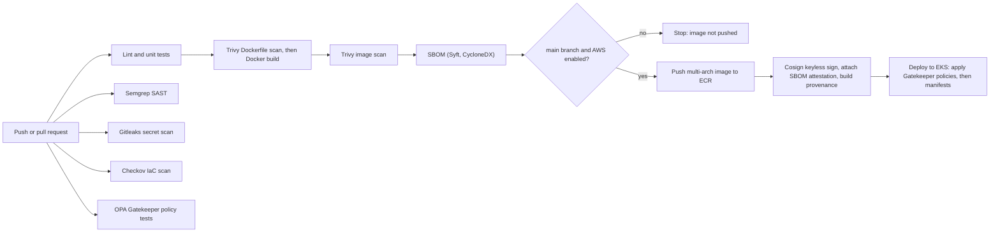

# DevSecOps CI/CD Pipeline


A GitHub Actions pipeline that builds, tests and security-checks a small Python
(FastAPI) service, then signs the container image and deploys it to Amazon EKS.
Most security checks run as separate jobs, so a failure points to one control.

## What the pipeline does

On every push and pull request to `main`, `.github/workflows/build.yml` runs these jobs:

| Job | What it does |
| --- | --- |
| Lint and unit tests | flake8, black, isort, then pytest with a minimum of 80% coverage |
| SAST (Semgrep) | Scans `app/` with the Semgrep `auto` rule set and uploads SARIF to code scanning |
| Secret scan (Gitleaks) | Scans the full Git history for committed secrets |
| IaC scan (Checkov) | Scans `terraform/` and `kubernetes/` for misconfiguration |
| Policy tests (OPA Gatekeeper) | Runs `gator verify` unit tests for the Gatekeeper policies |
| Build, scan, SBOM and sign image | Trivy config scan of the Dockerfile, Docker build, Trivy image scan, CycloneDX SBOM (Syft), then on `main` with AWS enabled: multi-arch push to ECR, Cosign keyless signing, SBOM attestation and build provenance |

`.github/workflows/deploy.yml` runs after a successful build on `main`. It
applies the Gatekeeper policies and the Kubernetes manifests to the EKS cluster,
then waits for the rollout. `.github/workflows/security.yml` repeats the
Semgrep and Trivy scans every day at 03:00 UTC, so new advisories are caught
without a code change.

Third-party actions are pinned to full commit SHAs.

## Pipeline stages



## Security controls

| Control | Tool | Where | Effect on the pipeline |
| --- | --- | --- | --- |
| Static analysis of application code | Semgrep | `sast` job, daily scan | Any finding fails the build |
| Secrets in Git history | Gitleaks | `secrets` job | Any finding fails the build |
| Terraform and Kubernetes misconfiguration | Checkov | `iac` job | Reports only (soft fail) |
| Dockerfile misconfiguration | Trivy (config) | `image` job | HIGH or CRITICAL fails the build |
| Image vulnerabilities | Trivy (image) | `image` job, daily scan | Reports HIGH and CRITICAL with a fix; does not fail the build |
| Software bill of materials | Syft (CycloneDX) | `image` job | Stored as a build artefact; attached to the image as a Cosign attestation when pushed |
| Image signing | Cosign (keyless, GitHub OIDC) | `image` job, `main` only | Signs the pushed image digest |
| Build provenance | `actions/attest-build-provenance` | `image` job, `main` only | Provenance attestation pushed to the registry |
| Kubernetes admission policy | OPA Gatekeeper | `policy` job (tests), deploy (apply) | Policy tests fail the build; in the cluster all constraints are in `dryrun` (audit) mode |
| Container hardening | Kubernetes `securityContext` | `kubernetes/deployment.yaml` | Non-root user, no privilege escalation, read-only root filesystem, CPU and memory limits |

Limits that apply today:

- The Gatekeeper "require signed images" template is a placeholder. It matches
  a fixed digest suffix and does not verify Cosign signatures. Signature
  verification at admission needs a verifier such as Sigstore policy-controller.
- The Gatekeeper constraints run in audit mode. They report violations but do
  not block Pods.

## Repository layout

| Path | Contents |
| --- | --- |
| `app/` | FastAPI service (`/health`, `/metrics`, `/logs`), Dockerfile and tests |
| `.github/workflows/` | Build, deploy and scheduled security workflows |
| `kubernetes/` | Deployment, Service, Ingress, External Secrets, monitoring values |
| `kubernetes/policies/gatekeeper/` | Gatekeeper templates, constraints and `gator` tests |
| `terraform/` | VPC and EKS cluster (terraform-aws-modules) |
| `docs/` | Container security, secrets management and naming conventions |

## How to run it

### Locally

Requirements: Python 3.11 and Docker.

```bash
python -m venv .venv && . .venv/bin/activate
pip install -r app/requirements.txt flake8 pytest

flake8 app/ && black --check app/ && isort --check-only app/
pytest --cov=app --cov-fail-under=80 app/tests/

docker build -t devsecops-app ./app
docker run --rm -p 8000:8000 devsecops-app
curl http://localhost:8000/health
```

Optional local scans, if the tools are installed:

```bash
semgrep scan --config=auto app/
gitleaks git .
checkov -d terraform/ --framework terraform
trivy image devsecops-app
gator verify kubernetes/policies/gatekeeper/tests/
```

### In GitHub Actions without AWS

Fork or clone the repository and push to `main` or open a pull request. All
jobs run up to and including the SBOM. The push, signing and deploy steps are
skipped.

### In GitHub Actions with AWS

1. Create the VPC and EKS cluster with Terraform (`terraform/`). The deploy
   workflow expects a cluster named `devsecops-eks` in `us-east-1`.
2. Create an ECR repository named `devsecops-app`.
3. Install OPA Gatekeeper in the cluster (see `kubernetes/policies/gatekeeper/README.md`).
4. Add the repository secrets `AWS_ACCESS_KEY_ID` and `AWS_SECRET_ACCESS_KEY`.
5. Add the repository variable `AWS_DEPLOY_ENABLED` with the value `true`.

The next push to `main` then pushes, signs and deploys the image.

## Further reading

- [Security and quality gates](SECURITY.md)
- [Container security and supply chain](docs/container-security.md)
- [Secrets management](docs/secrets-management.md)

## Licence

MIT. See [LICENSE](LICENSE).
