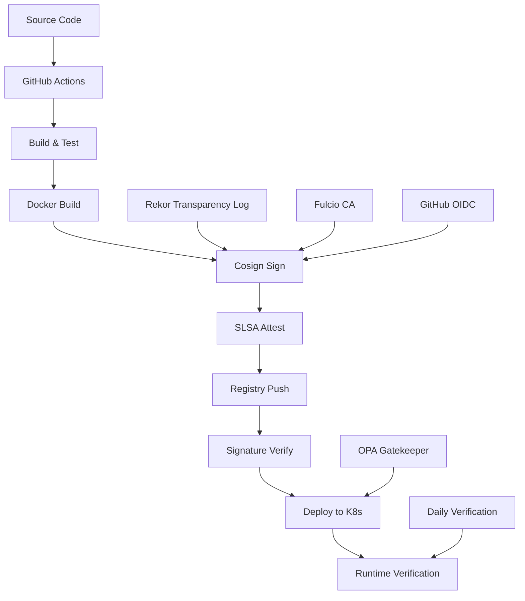

# Container Security and Supply Chain Attestation

This document outlines our advanced container security implementation using Cosign for image signing, SLSA provenance generation, and supply chain attestation.

## 🔐 Security Features

### Image Signing with Cosign
- **Keyless Signing**: Uses GitHub OIDC for secure, keyless image signing
- **Sigstore Integration**: Leverages Sigstore's transparency log (Rekor) for public verification
- **Multi-Architecture**: Signs both AMD64 and ARM64 images
- **Automatic Verification**: Images are verified before deployment

### SLSA Provenance
- **Build Attestation**: Every image includes cryptographic proof of build process
- **Supply Chain Transparency**: Full traceability from source code to deployed image
- **GitHub Native**: Uses GitHub's built-in attestation service
- **Tamper Detection**: Any modification to the image invalidates the provenance

### Supply Chain Security
- **Software Bill of Materials (SBOM)**: Complete inventory of all components
- **Vulnerability Scanning**: Trivy scans for known vulnerabilities
- **Policy Enforcement**: OPA Gatekeeper policies require signed images
- **Continuous Verification**: Daily verification of all deployed images

## 🏗️ Implementation Architecture



## 🔑 Signing Process

### 1. Build-Time Signing
```yaml
# In GitHub Actions
- name: Sign container image
  run: |
    cosign sign --yes ${{ env.REGISTRY }}/${{ env.IMAGE_NAME }}@${{ steps.image.outputs.digest }}
```

The signing process:
1. **Identity Verification**: GitHub OIDC token proves workflow identity
2. **Certificate Generation**: Fulcio CA issues short-lived certificate
3. **Signature Creation**: Image digest is signed with ephemeral key
4. **Transparency Log**: Signature is recorded in Rekor for public verification
5. **Registry Storage**: Signature is stored alongside the image

### 2. SLSA Provenance Generation
```yaml
- name: Generate SLSA provenance
  uses: actions/attest-build-provenance@v1
  with:
    subject-name: ${{ env.REGISTRY }}/${{ env.IMAGE_NAME }}
    subject-digest: ${{ steps.image.outputs.digest }}
    push-to-registry: true
```

Provenance includes:
- **Builder Identity**: GitHub Actions workflow
- **Source Repository**: Exact commit and branch
- **Build Parameters**: Environment variables and inputs
- **Dependencies**: All build-time dependencies
- **Timestamp**: When the build occurred

## 🛡️ Verification Process

### Pre-Deployment Verification
```bash
# Verify signature
cosign verify \
  --certificate-identity-regexp="https://github.com/your-org/your-repo" \
  --certificate-oidc-issuer="https://token.actions.githubusercontent.com" \
  your-registry/your-image@sha256:digest

# Verify SLSA provenance
cosign verify-attestation \
  --type slsaprovenance \
  --certificate-identity-regexp="https://github.com/your-org/your-repo" \
  --certificate-oidc-issuer="https://token.actions.githubusercontent.com" \
  your-registry/your-image@sha256:digest
```

### Runtime Policy Enforcement
```yaml
# OPA Gatekeeper policy
apiVersion: constraints.gatekeeper.sh/v1beta1
kind: RequireSignedImages
metadata:
  name: must-be-signed
spec:
  match:
    kinds:
      - apiGroups: ["apps"]
        kinds: ["Deployment", "DaemonSet", "StatefulSet"]
```

## 📊 Security Attestations

### What Gets Attested
1. **Build Provenance** (SLSA Level 3)
   - Source repository and commit
   - Build environment and parameters
   - Dependencies and their versions
   - Build timestamp and duration

2. **Software Bill of Materials (SBOM)**
   - All installed packages and versions
   - License information
   - Vulnerability status
   - Package sources and hashes

3. **Container Metadata**
   - Base image information
   - Layer composition
   - Security scan results
   - Configuration parameters

### Attestation Storage
- **Registry Integration**: Attestations stored in OCI registry
- **Sigstore Transparency**: Public log in Rekor
- **GitHub Attestations**: Native GitHub attestation service
- **Policy Integration**: Available to admission controllers

## 🔍 Verification Commands

### Manual Verification
```bash
# Download and inspect signature
cosign tree your-registry/your-image:tag

# Download SLSA provenance
cosign download attestation your-registry/your-image@sha256:digest \
  --predicate-type=https://slsa.dev/provenance/v0.2

# Download SBOM
cosign download sbom your-registry/your-image@sha256:digest

# Verify with custom policy
cosign verify your-registry/your-image@sha256:digest \
  --certificate-identity=your-expected-identity \
  --certificate-oidc-issuer=https://token.actions.githubusercontent.com
```

### Automated Verification
```bash
# Kubernetes admission controller
kubectl apply -f kubernetes/image-policy.yaml

# CI/CD pipeline verification
cosign verify-blob --bundle cosign.bundle --signature signature.sig file.txt
```

## 🚨 Security Policies

### Image Acceptance Criteria
✅ **Required for Deployment:**
- Image must be signed with valid Cosign signature
- SLSA provenance must be present and valid
- Signature must match expected GitHub repository
- No critical vulnerabilities in Trivy scan
- SBOM must be complete and accurate

❌ **Deployment Blocked If:**
- Image signature is missing or invalid
- Provenance cannot be verified
- Signature identity doesn't match expected source
- Critical vulnerabilities detected
- SBOM is incomplete or missing

### Exemption Process
For emergency deployments or specific use cases:

1. **Create Security Exception**
   ```yaml
   # security-exception.yaml
   apiVersion: v1
   kind: ConfigMap
   metadata:
     name: security-exception
     annotations:
       security.exception/reason: "Emergency hotfix deployment"
       security.exception/approver: "security-team@company.com"
       security.exception/expires: "2024-01-15T00:00:00Z"
   ```

2. **Document Justification**
   - Business impact assessment
   - Risk analysis and mitigation
   - Temporary nature confirmation
   - Follow-up remediation plan

## 📈 Monitoring and Alerting

### Security Metrics
- **Signature Coverage**: Percentage of deployed images that are signed
- **Verification Success Rate**: Successful verifications vs. total attempts
- **Policy Violations**: Number of deployment attempts blocked
- **Certificate Expiry**: Monitoring for expiring certificates
- **Supply Chain Drift**: Changes in dependencies or build process

### Alerting Rules
```yaml
# Example Prometheus alerting rules
groups:
- name: container-security
  rules:
  - alert: UnsignedImageDeployed
    expr: unsigned_images_deployed > 0
    for: 0m
    annotations:
      summary: "Unsigned container image deployed"
      
  - alert: SignatureVerificationFailed
    expr: signature_verification_failures > 5
    for: 5m
    annotations:
      summary: "High number of signature verification failures"
```

### Dashboard Metrics
- Real-time signature verification status
- SLSA provenance coverage percentage
- Supply chain security posture score
- Vulnerability trends over time
- Policy compliance statistics

## 🔧 Troubleshooting

### Common Issues

#### Signature Verification Fails
```bash
# Check signature exists
cosign verify your-registry/your-image@sha256:digest

# Common causes:
# 1. Image not signed
# 2. Wrong certificate identity
# 3. Expired certificate
# 4. Network issues with Rekor/Fulcio
```

#### SLSA Provenance Missing
```bash
# Check attestations
cosign tree your-registry/your-image:tag

# Possible issues:
# 1. Attestation step failed in CI/CD
# 2. Registry doesn't support attestations
# 3. Permissions issue
```

#### Policy Violations
```bash
# Check Gatekeeper constraints
kubectl get constraints

# Debug specific violation
kubectl describe constraint require-signed-images
```

### Recovery Procedures

#### Emergency Deployment
1. Create security exception (see above)
2. Apply exception to cluster
3. Deploy unsigned image temporarily
4. Create ticket for proper signing
5. Replace with signed image ASAP

#### Certificate Issues
1. Check Fulcio CA status
2. Verify GitHub OIDC configuration
3. Re-run signing workflow
4. Update certificate trust roots if needed

## 📚 References

- [Cosign Documentation](https://docs.sigstore.dev/cosign/overview/)
- [SLSA Framework](https://slsa.dev/)
- [Sigstore Architecture](https://docs.sigstore.dev/system_config/architecture/)
- [OPA Gatekeeper](https://open-policy-agent.github.io/gatekeeper/)
- [GitHub Attestations](https://docs.github.com/en/actions/security-guides/using-artifact-attestations-to-establish-provenance-for-builds)

## 🔄 Maintenance

### Regular Tasks
- **Weekly**: Review security dashboard and metrics
- **Monthly**: Update Cosign and related tools
- **Quarterly**: Review and update security policies
- **Annually**: Security architecture review and threat modeling

### Version Updates
```bash
# Update Cosign version in workflow
cosign-release: 'v2.2.0'  # Update to latest stable

# Update policy templates
kubectl apply -f kubernetes/image-policy.yaml

# Test verification with new versions
cosign verify --help  # Check for new features
``` 